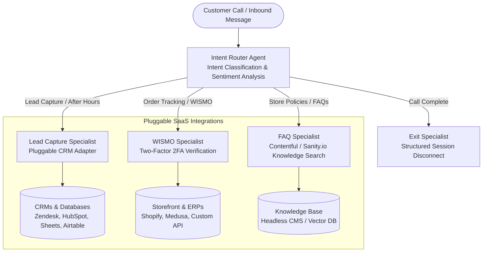
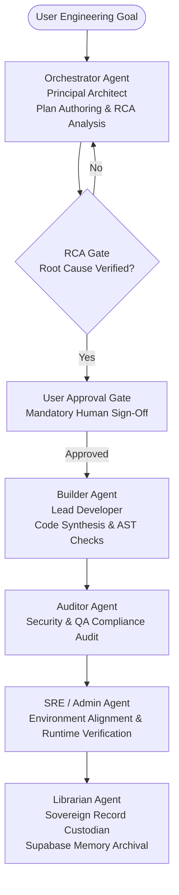

# David Nguyen — Technical Operations & Agent Management Portfolio

**Systems Integrator | AI Solutions Architect | E-Commerce Entrepreneur**  
Santa Ana, CA | [LinkedIn](https://linkedin.com/in/davidnguyen029) | [GitHub](https://github.com/dnguyen029) | dnguyen029@gmail.com

[](https://www.python.org/downloads/)
[](https://antigravity.google/docs)
[](https://google.github.io/agent-development-kit/)
[](https://cloud.google.com/run)
[](https://cloud.google.com/vertex-ai)
[](https://modelcontextprotocol.io/)
[](LICENSE)

---

A production-grade AI systems portfolio showcasing an end-to-end agentic engineering lifecycle built with **Google Antigravity**:

1. **The Multi-Agent Swarm SDK**: A development system built inside Google Antigravity IDE and packaged into a Python SDK to automate coding, security audits, and testing with strict human approval gates.  
   *Live Repository*: **[github.com/dnguyen029/antigravity-sdk](https://github.com/dnguyen029/antigravity-sdk)**
2. **The Voice AI Receptionist**: A live 24/7 customer support phone assistant built using the Google Agents ADK/CLI and deployed to Google Cloud Run to answer calls, track orders, and capture leads in real time.  
   *Live Repository*: **[github.com/dnguyen029/receptionist-template](https://github.com/dnguyen029/receptionist-template)**

---

## Executive Overview & Business Value

| Business Challenge | AI Solution Implemented | Operational Impact |
| :--- | :--- | :--- |
| **Missed After-Hours Inquiries** | Autonomous voice receptionist answers calls 24/7 with pluggable CRM/Database dispatching. | Zero dropped leads; automatic real-time ticket sync into **Zendesk, HubSpot, Salesforce, Airtable, or Google Sheets**. |
| **High Support Ticket Volume** | Self-service order lookup (WISMO) integrated with **Shopify, Medusa, or custom ERPs**. | Deflects ~70% of repetitive tracking calls; enforces **Two-Factor Verification** to protect customer data. |
| **Unreliable LLM Code Generation** | Multi-agent engineering swarm with strict **Human-in-the-Loop Approval Gates**. | Code modifications require an approved Root Cause Analysis (RCA) and user sign-off before modifying files. |
| **Conversational Latency** | Low-latency audio streaming optimized with a **<40-word turn budget**. | Natural spoken conversation cadence without awkward pauses or robotic monologue. |

---

## System 1 — Multi-Agent Conversational Receptionist

A standalone, decoupled AI receptionist handling inbound customer contacts for headless digital storefronts and enterprise backends. The system classifies caller intent in real time and routes to a specialized subagent via the **Agents CLI** and **A2A (Agent-to-Agent)** framework—without ever exposing the hand off.

* **Live Repository**: [github.com/dnguyen029/receptionist-template](https://github.com/dnguyen029/receptionist-template)

### Architecture & Intent Routing



### Key Engineering Features

* **Headless Commerce Orchestration** — Decoupled frontend built with **Next.js** interacting with **Medusa** and **Shopify** backends via custom webhook event structures.
* **Two-Factor Record Verification** — Enforces strict two-factor verification (Caller ID + PO/Order Number) before disclosing any customer PII over telephony.
* **Low-Latency Spoken Cadence** — Voice prompts enforce a strict **<40-word turn budget** to deliver crisp, natural cadence without conversational lag.
* **Dynamic Headless CMS & Next.js Sync** — Connected the **Next.js** storefront and **Headless CMS** layers via webhooks so product updates and store policies dynamically sync across both the live website and the AI voice agent in real time with zero manual redeploys.
* **Idempotent Dispatch** — Generates unique session idempotency keys for Zendesk and Google Sheets to eliminate duplicate records during network retries.

### Production Deployment

| Property | Value |
| :---- | :---- |
| **Platform** | Google Cloud Run |
| **Service Name** | `receptionist-prod` |
| **Region** | `us-west1` / `us-central1` |
| **Authentication** | Google Default Identity (OIDC) |
| **Runtime** | FastAPI + Uvicorn |

### Webhook Endpoints

| Route | Purpose |
| :---- | :---- |
| `/webhook/write-to-sheets` | Lead capture ➔ Google Sheets + Zendesk API |
| `/webhook/wismo-lookup` | Order status lookup by PO number via backend APIs |
| `/webhook/faq-lookup` | Grounded FAQ answer from headless CMS knowledge base |

---

## System 2 — Governed Multi-Agent Swarm

A 5-agent autonomous engineering swarm featuring strict, programmatic enforcement gates designed for structured, auditable development tasks with **mechanical governance**.

* **Live Repository**: [github.com/dnguyen029/antigravity-sdk](https://github.com/dnguyen029/antigravity-sdk)

### Swarm Handoff & Governance Flow



### Roles and Responsibilities

| Agent | Role | Decision-Making Authority |
| :---- | :---- | :--- |
| **Orchestrator** | Principal Architect | System architecture, RCA enforcement, task delegation |
| **Builder** | Lead Developer | Code synthesis, AST validation, systems integration |
| **Auditor** | Security & Compliance | Security hardening, vulnerability audit, quality gate |
| **Admin / SRE** | Infrastructure Management | Environment alignment, test execution, runtime health |
| **Librarian** | Documentation & Memory | **Sole Record Custodian** for all permanent project knowledge |

### Governance Framework & Enforced Protocols

| Rule | Policy Mandate |
| :---- | :--- |
| **Diagnose Before Fix (RCA Gate)** | Mandatory root cause analysis before modifying code. Blocks file edits without visible symptoms, technical root cause, and resolution plan. |
| **Plan Approval Gate** | Strictly prohibits file modifications and mutating terminal commands until the stakeholder explicitly approves the implementation plan. |
| **Sovereign Record Custodian** | Write access to long-term vector memory is restricted exclusively to the Librarian persona to prevent knowledge corruption. |
| **Defensive Directory Barriers** | Security hooks physically block access to protected directories (`.git`, `.venv`, `node_modules`). |
| **Resource Optimization (TOON MCP)** | Compresses verbose JSON payloads to reduce token overhead by 40–60% across multi-turn context windows. |
| **Zero Inference Standard** | Operates strictly on verified parameters; ambiguity triggers an immediate stop-work-and-verify protocol. |

---

## Systems Integration Layer

Four core services support organizational memory, token compression, and high-authority research:

| Service | Role |
| :---- | :--- |
| **TOON MCP Server** | Custom Model Context Protocol server executing row-based token payload compression for high-frequency tool outputs. |
| **Supabase Vector Vault** | Secured corporate memory bank storing embeddings and lessons learned across sessions. |
| **Supermemory** | Semantic knowledge retrieval for cross-session project context. |
| **Exa Search** | High-authority web research and documentation scraping engine. |

### 📊 TOON Protocol Empirical Compression Benchmarks

To eliminate context window exhaustion and reduce inference costs during multi-turn agent tool execution, the custom **TOON MCP Server** extracts repetitive dictionary schemas into pipe-delimited matrix vectors:

| Payload Type | Structure & Context | Raw JSON | TOON Format | Token Reduction | Compression Ratio |
| :--- | :--- | :--- | :--- | :--- | :--- |
| **Scalar Object** | 3-field response payload | 17 tokens | 13 tokens | **23.5%** | `0.771` |
| **Order History** | 10 e-commerce order entities | 347 tokens | 154 tokens | **55.6%** | `0.444` |
| **Call Telemetry Batch** | 20 telephony event records | 560 tokens | 184 tokens | **67.1%** | `0.329` |

#### Architectural Transformation
* **Raw JSON Overhead (560 tokens)**: Redundantly serializes dictionary keys (`call_id`, `duration`, `disposition`, `agent`, `sentiment`) across every row.
* **TOON Compression (184 tokens — 67.1% reduction)**: Extracts the schema once into a typed header (`logs[20|]{call_id,duration,...}:`) and streams values as pipe-delimited vectors, guaranteeing 100% lossless round-trip fidelity upon decode.

---

## Repository Structure

```text
antigravity-portfolio/
├── native_orchestrator.py       # SDK-native Swarm Orchestration Engine 
├── RECEPTIONIST_SOP.md          # Architecture, endpoints, and data schema SOP
├── pyrightconfig.json           # Type checking configuration
└── app_build/
    └── receptionist/
        └── app/
            ├── agent.py                 # ADK multi-agent routing topology 
            ├── agent_runtime_app.py     # FastAPI server deployment entrypoint 
            ├── tools.py                 # Tool declarations and bindings 
            └── tools_lib/
                ├── sheets.py            # Google Sheets client interface
                └── zendesk.py           # Zendesk REST API client interface
```

---

## Project Operations & Architecture Scope

This repository is a portfolio showcase containing stubs and interfaces of the production codebases. To run the full system in a production environment, refer to the private operational repositories.

**Environment**: Design patterns conform to the Google Antigravity 2.0 SDK and Google Agents SDK (ADK) interfaces.

---

## Tech Stack

* **Languages**: Python 3.11+, TypeScript, SQL
* **AI & Agent Frameworks**: Google Antigravity 2.0 SDK, Google Agent Development Kit (ADK), Gemini Live / Flash, Vertex AI
* **Protocols & Standards**: Model Context Protocol (MCP), TOON Protocol, OpenAPI / REST, WebSockets / WebRTC
* **Cloud & Infrastructure**: Google Cloud Run, Cloud Storage, Google Secret Manager, Vercel, Railway
* **Integrations & Data**: Supabase Vector Memory, Google Sheets API, Zendesk API, Medusa, Shopify, Contentful, Sanity.io, Exa Search

---

## License
This portfolio repository is licensed under the MIT License — see the [LICENSE](LICENSE) file for details.
