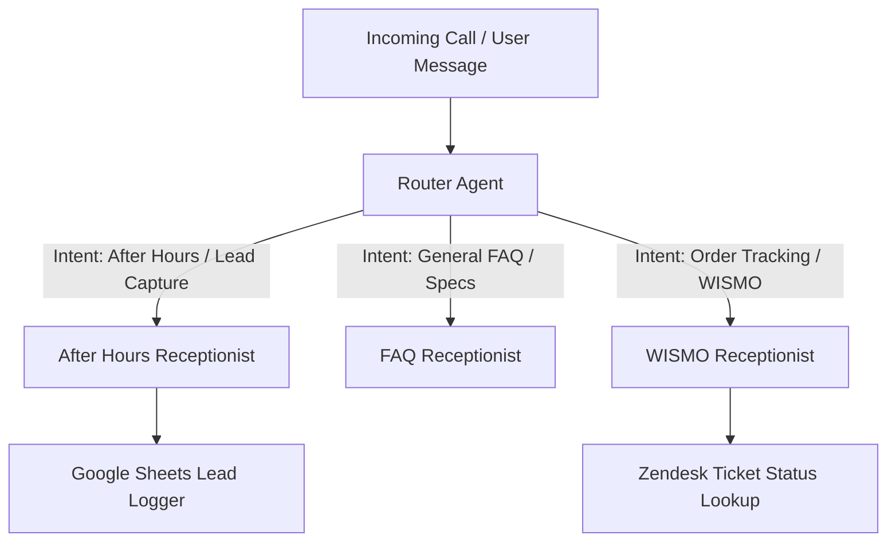

# AI Receptionist System Standard Operating Procedure (SOP)

This document defines the architecture, file layout, endpoints, data schemas, and guidelines for the decoupled AI Receptionist system. 

---

## 🎯 System Architecture

The receptionist system handles incoming customer calls/messages via a Root Router, delegating to specialized agents based on user intent:

---

## 📁 File Registry

All files relevant to the Receptionist system are organized below:

### 1. Agent Directives (Prompts)

* **[After Hours Receptionist](file:///app_build/receptionist/app/agents/receptionist.txt)**: Prompt instructing lead-capture behavior.
* **[Router Agent](file:///app_build/receptionist/app/agents/router.txt)**: Prompt for intent classification and subagent delegation.
* **[FAQ Receptionist](file:///app_build/receptionist/app/agents/faq_receptionist.txt)**: Prompt for answering product/brand specifications.
* **[WISMO Receptionist](file:///app_build/receptionist/app/agents/wismo_receptionist.txt)**: Prompt for PO lookup and ticket status check.

### 2. Integration Tools & Code

* **[Lead Logger (Sheets)](file:///app_build/receptionist/app/tools_lib/sheets.py)**: Python tool handling lead uploads to Google Sheets.
* **[Zendesk Integration](file:///app_build/receptionist/app/tools_lib/zendesk.py)**: Python tool handling Zendesk ticket searches, updates, and creation.
* **[Execution Entrypoint](file:///app_build/receptionist/app/tools.py)**: Python tools wrapper routing lead logging and WISMO lookup.

---

## 📡 Deployment & Integration

* **Google Cloud Project**: `your-gcp-project-id`
* **Service Name**: `receptionist-prod` (hosted on Google Cloud Run)
* **Cloud Run Webhook Base URL**: `https://your-cloudrun-service-url.run.app`
* **Dialogflow CX Webhook Integration**: `https://your-cloudrun-service-url.run.app/webhook/detect`

### Webhook Endpoints

All webhook calls map to the Cloud Run service path:
* **Lead Logging (`/log_lead`)**: 
  * Saves callback lead details to Google Sheets.
  * Checks for `ticket_id`. If `ticket_id` is present, it runs an update to save the call summary as an internal private comment on the existing ticket.
  * If `ticket_id` is absent/empty, it invokes `create_ticket` to generate a new Zendesk ticket auto-assigned to the user configured in `ZENDESK_EMAIL`.
* **Order Status Lookup (`/wismo_lookup`)**:
  * **Input Payload**: `{"purchase_order": "PO-XXXXXX"}`
  * **Response Format**: `{"success": true, "found": true, "status": "shipped", "carrier": "FedEx", "tracking_number": "1Z...", "details": "..."}`
* **FAQ Grounding (`/faq_lookup`)**:
  * **Input Payload**: `{"query": "User question here"}`
  * **Response Format**: `{"success": true, "answer": "Response answer text...", "source": "..."}`

---

## 📋 Data Schema

All captured session parameters must conform to the following properties before logging:

| Parameter | Type | Required | Formatting / Validation |
| :--- | :--- | :--- | :--- |
| `name` | String | Yes | Captured customer name. |
| `phone_number` | String | Yes | Must be validated and stored in E.164 format (e.g. `+1XXXXXXXXXX`). |
| `email` | String | Yes | Captured email address. |
| `purchase_order` | String | No | PO number (only collected for WISMO / order flows). |
| `intent` | String | Yes | Intent classification (`Lead Capture`, `FAQ`, `WISMO`). |
| `urgency` | String | Yes | Urgency flag (`high` if user mentions emergency keywords like leak/flood/water damage, else `low`). |
| `sentiment` | String | Yes | Customer sentiment (`negative` if user sounds frustrated/angry, else `neutral`). |

---

## 🛡️ Core Conversational Rules

To ensure a high-quality call experience, all receptionist prompts must enforce these constraints:

1. **Strict Response Limit**: Maximum of **40 words** per response to maintain low latency.
2. **One Question at a Time**: Never ask the caller for multiple details in a single response.
3. **Mandatory Readback Verification**: You MUST read back both the phone number and the email address, confirming they are correct before calling logging tools.
4. **Single-Shot Logging**: Collect all required user details before invoking the Lead Logger tool.
5. **No AI Identity Disclosures**: Never mention being an AI or a bot; maintain the virtual assistant persona.
6. **Website Referral fallback**: Refer callers seeking deep technical specs or complex policies to your company's website.
